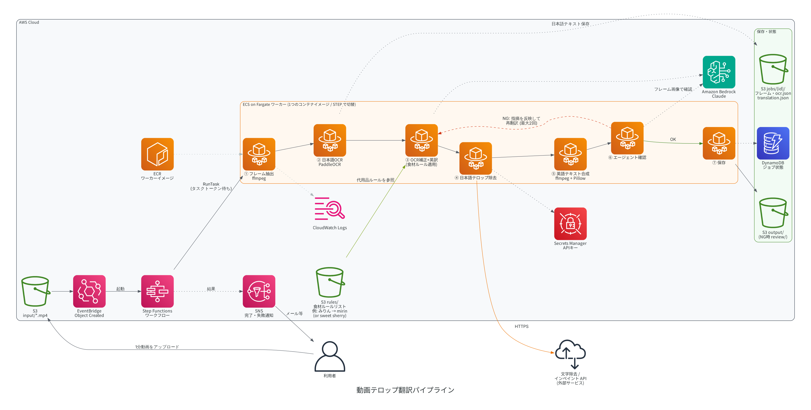

# VideoTranslater

S3 に日本語テロップ入りの動画 (1分程度) を置くと、テロップを英語に差し替えた動画を作って保存する AWS パイプラインです。



## 処理の流れ

| # | 工程 | 実装 | 主な出力 (`jobs/{job_id}/`) |
|---|------|------|------|
| ① | フレーム抽出 | ffmpeg (正規化 + 4fps でサンプリング) | `source.mp4`, `frames.tar`, `frames.json` |
| ② | 日本語OCR | PaddleOCR (`lang=japan`)。連続フレームで同じテロップを1区間にまとめる | `ocr.json` (文字・位置・開始/終了時刻) |
| ③ | OCR補正 + 英訳 | Amazon Bedrock (Claude)。切り抜き画像を見て誤認識を直し、枠に収まる長さで英訳 | `translation.json` |
| ④ | 日本語テロップ除去 | 専用ツール API (`INPAINT_PROVIDER=http`)。未設定時は ffmpeg delogo で代用 | `clean.mp4` |
| ⑤ | 英語テキスト合成 | Pillow で枠に収まるよう自動縮小・改行し、ffmpeg で焼き込み | `output.mp4`, `compose.json` |
| ⑥ | エージェント確認 | 機械チェック (はみ出し・日本語の消し残し) + Claude が完成フレームを見て判定 | `qa.json` |
| ⑦ | 保存 | 合格: `output/{名前}_en.mp4` / 不合格: `review/{名前}_en.mp4` + 結果 JSON | DynamoDB にステータス |

⑥ で NG の場合は、指摘内容を ③ に渡して「再翻訳 → 再合成 → 再確認」を最大2回繰り返します (`maxQaAttempts`)。
それでも NG なら `review/` に置き、SNS で通知します。

Amazon Rekognition / Textract は日本語の文字認識に対応していないため、OCR は PaddleOCR をコンテナ内で動かしています。

## ディレクトリ

```
infra/     AWS CDK (Python) — S3, EventBridge, Step Functions, ECS Fargate, DynamoDB, SNS, Secrets Manager
worker/    全工程を実行するコンテナ (STEP 環境変数で工程を切り替え)
gpu-worker/ 工程④ を GPU (AWS Batch) で ProPainter 実行するコンテナ
  vt/steps/        各工程の実装
  vt/segments.py   OCR 結果をテロップ区間にまとめるロジック
  vt/render.py     英文を枠に収めて画像化
  vt/inpaint_providers.py  文字除去 API の切り替え
docs/architecture/ 構成図 (PNG / SVG / draw.io) と生成スクリプト
scripts/local_smoke.py     AWS なしでの動作確認
```

## デプロイ

前提: AWS CLI の認証、Node.js (CDK CLI)、Docker、Bedrock で Claude のモデルアクセスが有効になっていること。

```bash
cd infra
python -m venv .venv && source .venv/bin/activate
pip install -r requirements.txt
npx cdk bootstrap          # 初回のみ
npx cdk deploy
```

設定は `infra/cdk.json` の `context` で変更できます。

| キー | 既定値 | 説明 |
|------|--------|------|
| `bedrockRegion` | `us-east-1` | Bedrock を呼ぶリージョン |
| `bedrockModelId` | `anthropic.claude-opus-5-5` | 翻訳・確認に使うモデル |
| `inpaintProvider` | `propainter_local` | AWS Batch + GPU の ProPainter。`ffmpeg_delogo` で GPU なしの簡易版、`replicate` で ProPainter (Replicate)、`http` で任意の専用ツール API |
| `maxQaAttempts` | `2` | QA NG 時の再試行回数 |

### 文字除去に ProPainter を AWS Batch + GPU で使う (おすすめ)

```bash
cdk deploy   # 既定で propainter_local
```

- 工程④だけ AWS Batch の GPU インスタンス (g6.xlarge / g5.xlarge) で動きます。ジョブが無いときは 0 台で課金されません。
- 先に Service Quotas で「Running On-Demand G and VT instances」を 8 vCPU 以上に引き上げてください (初期値 0 のアカウントがあります)。
- 動画全体ではなくテロップの周り (前後 2 秒) だけを切り出して処理するので、GPU メモリ 24GB で 1 分の動画に収まる想定です。
- 調整用 context: `gpuInstanceTypes` (既定 `["g6.xlarge","g5.xlarge"]`)、`gpuMaxVcpus` (既定 8)、`gpuSpot` (true でスポット、約 6〜7 割引)、`propainterSubvideoLength` (GPU メモリ不足時に小さく)。
- ProPainter は S-Lab License (非商用)。商用で使う場合は著作者の許諾が必要です。
- GPU イメージは約 10GB あり、初回の `cdk deploy` はビルドと push に時間がかかります。

### 文字除去に ProPainter (Replicate) を使う

`inpaintProvider` を `replicate` にして再デプロイし、`InpaintSecretArn` に次を入れます
(バージョン ID と入力名は https://replicate.com/jd7h/propainter/api で確認)。

```bash
aws secretsmanager put-secret-value --secret-id <InpaintSecretArn> \
  --secret-string '{"api_token":"r8_...","version":"<version id>","video_field":"video","mask_field":"mask"}'
```

### 専用ツール API の設定

デプロイ後、出力された `InpaintSecretArn` に認証情報を入れ、`inpaintProvider` を `http` にして再デプロイします。

```bash
aws secretsmanager put-secret-value --secret-id <InpaintSecretArn> \
  --secret-string '{"endpoint":"https://api.example.com","api_key":"..."}'
```

`worker/vt/inpaint_providers.py` の `HttpInpaintProvider` は「動画 + マスク動画を送ってジョブを作り、完了をポーリングして結果をダウンロードする」形のひな形です。実際の API 仕様に合わせて修正してください。

## 食材ルールリスト

`rules/ingredients.json` を S3 の `rules/ingredients.json` に置くと、③ の翻訳がこのリストの表記を使います
(例: みりん → `mirin (or sweet sherry)`)。リストに無い食材には代用品を付けません。ファイルが無ければルールなしで翻訳します。

```bash
aws s3 cp rules/ingredients.json s3://<BucketName>/rules/ingredients.json
```

## 使い方

```bash
aws s3 cp sample.mp4 s3://<BucketName>/input/sample.mp4
# 数分後
aws s3 ls s3://<BucketName>/output/
```

進行状況は DynamoDB の `JobsTable` (job_id = Step Functions の実行名) と Step Functions のコンソールで確認できます。

## ローカルでの確認

```bash
pip install -r worker/requirements-dev.txt
cd worker && python -m pytest -q          # ロジックのテスト
cd .. && python scripts/local_smoke.py    # テスト動画で 抽出→除去→合成 を実行 (OCR/翻訳は固定値)
```

単一工程をローカルの疑似ストレージで動かす場合:

```bash
cd worker
LOCAL_ROOT=../work/store JOB_ID=test INPUT_KEY=input/sample.mp4 python -m vt.main extract
```

## 構成図の再生成

```bash
pip install diagrams   # graphviz も必要
python docs/architecture/diagram.py      # PNG / SVG
python docs/architecture/make_drawio.py  # draw.io
```

## 未確定・今後の対応

- 専用ツール API の仕様に合わせた `HttpInpaintProvider` の実装
- Bedrock 用 IAM 権限をモデル ARN に絞る
- 縦書きテロップや、装飾の強いテロップ (色・フォント) の再現
